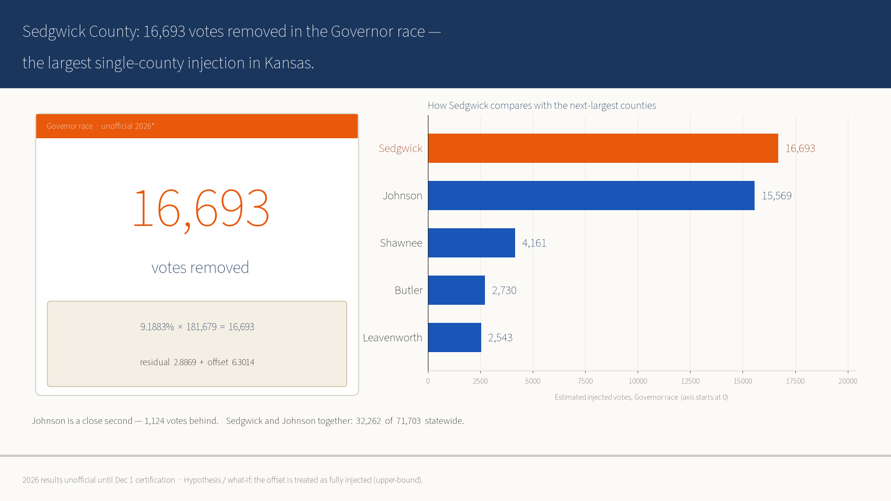

# Kansas Reverse Analysis

Private draft. 2026 figures are unofficial (Kansas SOS update 11/08/2026; certification December 1, 2026). This is a what-if simulation, not a finding of fact.

The full write-up, including methodology, is in [report/Kansas-Reverse-Analysis.md](report/Kansas-Reverse-Analysis.md). A standalone methodology page is in [docs/Methodology.md](docs/Methodology.md). County tables are in `data/`. Presentation graphics are in `graphics/`.

The locked Kansas Governor constant is S = 67.6004 × (D/100) + 6.3014. Each other statewide race uses its own 2026* fit. Estimated votes are the residual from that race’s line plus the offset, clamped at zero, then moved from Democrat to Republican with totals unchanged.

These race totals must not be added together. They describe the same voters.

Two independent verification passes over all 105 counties and all six races were required, with zero mismatches, before this repository was written. Cast vote record (CVR) access may be blocked; this analysis does not use CVRs.

This repository is private and is not part of the main Kansas Election Analysis repository.

_Saved Friday, Nov 27, 2026, 11:04 AM CT (America/Chicago)._

## Graphs

**Highlighted:** Sedgwick County is the largest single-county injection in the Governor race.

Sedgwick’s Governor total is 16,693 votes (9.1883% × 181,679). Johnson is a close second at 15,569, or 1,124 votes behind. Together they account for 32,262 of 71,703 statewide.

Other presentation graphics in `graphics/`:

- [When you remove the injection equation / share injection, this is what happens](graphics/1_KS_senate_injection_removed.png) — one graphic per statewide race (`1`–`6`)
- [Estimated injected votes by race](graphics/7_KS_votes_removed_by_race.png) — one bar per race; do not add the bars
- [Top 10 counties by race](graphics/8_KS_top10_by_race.png)
