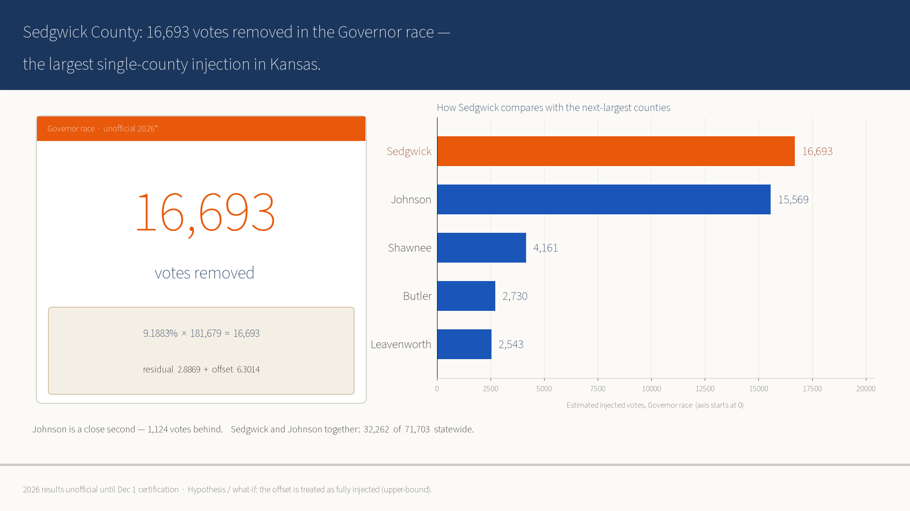

# Kansas Reverse Analysis

**Status:** private draft. 2026 figures are unofficial (Kansas Secretary of State election-night update of 11/08/2026; certification December 1, 2026).

This is a what-if simulation, not a finding of fact. The gap measured below is a statistical distance from a fitted line, not proof that any votes were injected. Treating the offset as fully injected is an upper-bound assumption. Cast vote record (CVR) access may be blocked; this analysis does not use CVRs.

The work was run by the analyst. Two independent verification passes were required; both completed with zero mismatches before these pages were written.

_Saved Friday, Nov 27, 2026, 11:04 AM CT (America/Chicago)._

## The Kansas constant

The locked Kansas Governor equation is

$$S = 67.6004 \times (D/100) + 6.3014$$

where **S** is the Democratic surplus (Democratic share of that race’s total votes minus the Democratic registration share, in points) and **D** is the actual Kansas SOS Democratic registration share, in points. The denominator is always that race’s total votes, never ballots cast. Kansas has official party registration; no stand-in is used.

The 6.3014 term is the locked-page **offset**. In this analysis it is the pad: each county’s estimated injection, in points, is the residual from the fitted line plus the offset, which simplifies to

$$\text{injection points} = S - m \times (D/100).$$

Points are converted to votes by multiplying by the county’s race total and dividing by 100. Negative results are set to zero. Those votes are then moved from the Democrat to the Republican in each county, leaving the race total unchanged (the transfer, or flip, view). A secondary subtract-only view removes the same votes from the Democratic count and from the total, leaving Republican votes unchanged.

Attorney General and the other statewide races use the same form, each with its own 2026 ordinary-least-squares fit across all 105 counties, except that Governor keeps the locked constants and Attorney General keeps its previously stated fit. Both of those pairs were recomputed from the raw files and match the earlier verified totals: Governor 71,703 votes and Attorney General 74,243 votes.

## Race constants (2026*)

| Race | Slope m | Offset b | R² | Source |
|---|---:|---:|---:|---|
| United States Senate | 69.2709 | 6.2765 | 0.6771 | Fitted on this race, rounded to four decimals |
| Governor | 67.6004 | 6.3014 | 0.6806 | Locked Governor constant |
| Secretary of State | 65.0917 | 3.8183 | 0.6904 | Fitted on this race, rounded to four decimals |
| Attorney General | 67.5582 | 6.4993 | 0.6680 | Stated Attorney General fit |
| State Treasurer | 69.6773 | -0.4427 | 0.7240 | Fitted on this race, rounded to four decimals |
| Commissioner of Insurance | 65.7184 | 3.6113 | 0.7150 | Fitted on this race, rounded to four decimals |

The Treasurer offset is slightly negative (−0.4427). In that race, residual plus offset is often smaller than the residual alone, and 58 counties clamp to zero.

## Statewide results

Primary view: transfer (move estimated votes from Democrat to Republican; totals unchanged). Secondary line: subtract-only.

| Race | 2026* before | After transfer | After subtract-only | Votes moved (counties) | Statewide flip? |
|---|---|---|---|---:|---|
| United States Senate | D +5.05 (+55,585) | R -8.59 (-94,529) | R -1.90 (-19,472) | 75,057 (102) | Yes, D → R |
| Governor | D +0.70 (+7,644) | R -12.40 (-135,762) | R -6.26 (-64,059) | 71,703 (101) | Yes, D → R |
| Secretary of State | R -0.81 (-8,817) | R -10.32 (-112,083) | R -5.84 (-60,450) | 51,633 (97) | No (stays R) |
| Attorney General | D +1.23 (+13,456) | R -12.36 (-135,030) | R -5.97 (-60,787) | 74,243 (103) | Yes, D → R |
| State Treasurer | R -6.88 (-74,556) | R -9.12 (-98,750) | R -8.09 (-86,653) | 12,097 (47) | No (stays R) |
| Commissioner of Insurance | R -1.59 (-17,203) | R -10.13 (-109,631) | R -6.12 (-63,417) | 46,214 (93) | No (stays R) |

Three races flip statewide under both views: United States Senate, Governor, and Attorney General. Secretary of State, State Treasurer, and Commissioner of Insurance are already Republican in the unofficial 2026* count and stay Republican, with a larger Republican margin after the transfer.

Unclamped (pre-clamp) rounded statewide sums, for the record: Senate 73,166; Governor 70,449; Secretary of State 45,931; Attorney General 73,432; Treasurer −1,471; Insurance 43,595. Treasurer’s unclamped sum is negative because the offset is negative and more than half the counties sit below zero.

These six injection totals describe the same voters looked at through six races. They must not be added together.

## Counties that flip under the transfer

All listed flips are Democrat → Republican. No county flips Republican → Democrat. Douglas, Johnson, Shawnee, and Wyandotte stay Democratic in every race after the transfer.

### United States Senate

Candidates: Adam Hamilton (D) vs Roger Marshall (R). Democratic counties before 11, after 4.

| County | Before | After transfer | Votes moved |
|---|---|---|---:|
| Finney | D +2.52 (+233) | R -21.84 (-2,017) | 1,125 |
| Ford | D +1.07 (+77) | R -16.02 (-1,153) | 615 |
| Geary | D +5.51 (+372) | R -18.66 (-1,260) | 816 |
| Lyon | D +8.10 (+916) | R -12.82 (-1,450) | 1,183 |
| Riley | D +21.14 (+4,232) | R -2.48 (-496) | 2,364 |
| Sedgwick | D +7.66 (+13,997) | R -10.37 (-18,955) | 16,476 |
| Seward | D +13.47 (+564) | R -18.91 (-792) | 678 |

### Governor

Candidates: Cindy Holscher (D) vs Ty Masterson (R). Democratic counties before 9, after 4.

| County | Before | After transfer | Votes moved |
|---|---|---|---:|
| Geary | D +0.06 (+4) | R -24.69 (-1,658) | 831 |
| Lyon | D +2.55 (+286) | R -18.44 (-2,068) | 1,177 |
| Riley | D +17.42 (+3,474) | R -6.20 (-1,236) | 2,355 |
| Sedgwick | D +4.66 (+8,463) | R -13.72 (-24,923) | 16,693 |
| Seward | D +8.96 (+374) | R -23.00 (-960) | 667 |

### Secretary of State

Candidates: Jennifer Day (D) vs Pat Proctor (R). Democratic counties before 9, after 4.

| County | Before | After transfer | Votes moved |
|---|---|---|---:|
| Geary | D +1.23 (+82) | R -20.52 (-1,370) | 726 |
| Lyon | D +0.83 (+91) | R -14.03 (-1,541) | 816 |
| Riley | D +14.63 (+2,903) | R -3.47 (-689) | 1,796 |
| Sedgwick | D +2.51 (+4,509) | R -11.51 (-20,647) | 12,578 |
| Seward | D +9.61 (+400) | R -20.28 (-844) | 622 |

### Attorney General

Candidates: Chris Mann (D) vs Kris Kobach (R). Democratic counties before 10, after 4.

| County | Before | After transfer | Votes moved |
|---|---|---|---:|
| Finney | D +1.13 (+104) | R -25.81 (-2,370) | 1,237 |
| Geary | D +0.39 (+26) | R -24.69 (-1,658) | 842 |
| Lyon | D +0.70 (+78) | R -18.45 (-2,054) | 1,066 |
| Riley | D +17.90 (+3,556) | R -6.22 (-1,236) | 2,396 |
| Sedgwick | D +5.01 (+9,073) | R -13.74 (-24,865) | 16,969 |
| Seward | D +10.80 (+450) | R -23.03 (-960) | 705 |

### State Treasurer

Candidates: Juan C. Luengo (D) vs Steven Johnson (R). Democratic counties before 6, after 4.

| County | Before | After transfer | Votes moved |
|---|---|---|---:|
| Riley | D +6.32 (+1,244) | R -0.45 (-88) | 666 |
| Seward | D +5.45 (+226) | R -18.42 (-764) | 495 |

### Commissioner of Insurance

Candidates: Dinah Sykes (D) vs Daniel Hawkins (R). Democratic counties before 6, after 4.

| County | Before | After transfer | Votes moved |
|---|---|---|---:|
| Riley | D +12.15 (+2,390) | R -3.81 (-750) | 1,570 |
| Seward | D +6.21 (+258) | R -18.97 (-788) | 523 |

## Top 10 counties by estimated injected votes

### United States Senate  —  75,057 votes in 102 counties

| Rank | County | Votes moved | County flips? |
|---:|---|---:|---|
| 1 | Johnson | 18,922 |  |
| 2 | Sedgwick | 16,476 | Yes, D → R |
| 3 | Shawnee | 4,288 |  |
| 4 | Leavenworth | 2,692 |  |
| 5 | Butler | 2,568 |  |
| 6 | Riley | 2,364 | Yes, D → R |
| 7 | Reno | 1,955 |  |
| 8 | Saline | 1,710 |  |
| 9 | Miami | 1,338 |  |
| 10 | Lyon | 1,183 | Yes, D → R |

### Governor  —  71,703 votes in 101 counties

| Rank | County | Votes moved | County flips? |
|---:|---|---:|---|
| 1 | Sedgwick | 16,693 | Yes, D → R |
| 2 | Johnson | 15,569 |  |
| 3 | Shawnee | 4,161 |  |
| 4 | Butler | 2,730 |  |
| 5 | Leavenworth | 2,543 |  |
| 6 | Riley | 2,355 | Yes, D → R |
| 7 | Reno | 1,970 |  |
| 8 | Saline | 1,728 |  |
| 9 | Miami | 1,263 |  |
| 10 | McPherson | 1,194 |  |

### Secretary of State  —  51,633 votes in 97 counties

| Rank | County | Votes moved | County flips? |
|---:|---|---:|---|
| 1 | Sedgwick | 12,578 | Yes, D → R |
| 2 | Johnson | 12,000 |  |
| 3 | Shawnee | 3,104 |  |
| 4 | Butler | 1,984 |  |
| 5 | Leavenworth | 1,950 |  |
| 6 | Riley | 1,796 | Yes, D → R |
| 7 | Reno | 1,336 |  |
| 8 | Saline | 1,197 |  |
| 9 | Finney | 967 |  |
| 10 | Miami | 891 |  |

### Attorney General  —  74,243 votes in 103 counties

| Rank | County | Votes moved | County flips? |
|---:|---|---:|---|
| 1 | Sedgwick | 16,969 | Yes, D → R |
| 2 | Johnson | 16,877 |  |
| 3 | Shawnee | 4,182 |  |
| 4 | Leavenworth | 2,889 |  |
| 5 | Butler | 2,701 |  |
| 6 | Riley | 2,396 | Yes, D → R |
| 7 | Reno | 2,062 |  |
| 8 | Saline | 1,764 |  |
| 9 | Miami | 1,265 |  |
| 10 | Finney | 1,237 | Yes, D → R |

### State Treasurer  —  12,097 votes in 47 counties

| Rank | County | Votes moved | County flips? |
|---:|---|---:|---|
| 1 | Sedgwick | 5,825 |  |
| 2 | Butler | 953 |  |
| 3 | Leavenworth | 921 |  |
| 4 | Riley | 666 | Yes, D → R |
| 5 | Finney | 521 |  |
| 6 | Seward | 495 | Yes, D → R |
| 7 | Geary | 458 |  |
| 8 | Lyon | 286 |  |
| 9 | Ford | 283 |  |
| 10 | Reno | 241 |  |

### Commissioner of Insurance  —  46,214 votes in 93 counties

| Rank | County | Votes moved | County flips? |
|---:|---|---:|---|
| 1 | Johnson | 11,131 |  |
| 2 | Sedgwick | 10,294 |  |
| 3 | Shawnee | 2,546 |  |
| 4 | Leavenworth | 2,042 |  |
| 5 | Butler | 1,892 |  |
| 6 | Riley | 1,570 | Yes, D → R |
| 7 | Reno | 1,417 |  |
| 8 | Saline | 1,204 |  |
| 9 | Miami | 824 |  |
| 10 | McPherson | 793 |  |

## Historical pattern (hypothesis)

**Hypothesis, not a finding.** The same surplus-line form can be fitted to prior cycles. A further hypothesis, sometimes described as a CD3-style saturation pattern, is that Democratic surplus in baseline high-Democratic counties flattens or falls while it grows in other counties — as if the baseline counties had little room left and any added support appeared elsewhere.

The 2022 Governor fit, recomputed here from official precinct results and November 2022 SOS registration on all 105 counties, is

$$S_{2022} = 40.1640 \times (D/100) + 11.1047$$

with R² = 0.3044 (mean absolute residual 3.49 points). That matches the previously published 2022 constants (m = 40.1640, b = 11.1047, R² = 0.3044). The 2026* locked line is steeper and has a lower offset (m = 67.6004, b = 6.3014, R² = 0.6806). The two years do not share one line.

A full 2018 surplus-line fit was **not** computed. Party registration by county for 2018 is not among the raw files on this computer, and the Kansas SOS site returns HTTP 403 here. The 2018 Governor precinct workbook is on hand, but the Wyandotte tab is a placeholder directing the reader to contact the SOS, so even the vote file is incomplete for all 105 counties.

### Saturation test (Governor surplus, 2022 official vs 2026*)

Baseline counties, as named in the request: Wyandotte, Douglas, Johnson, and Shawnee.

| Group | Mean surplus 2022 | Mean surplus 2026* | Change | Governor votes moved |
|---|---:|---:|---:|---:|
| Baseline four | 26.11 | 28.22 | +2.11 | 19,730 |
| Wyandotte and Douglas only | 24.87 | 29.19 | +4.31 | 0 |
| Johnson and Shawnee only | 27.34 | 27.25 | -0.09 | 19,730 |
| Other 101 counties | 16.93 | 15.29 | -1.64 | 51,973 |

| County | Dem. reg. 2022 | Dem. reg. 2026* | Surplus 2022 | Surplus 2026* | Change | Residual+pad votes (Gov.) |
|---|---:|---:|---:|---:|---:|---:|
| Wyandotte | 48.28% | 45.16% | 19.56 | 27.74 | +8.18 | 0 |
| Douglas | 45.34% | 45.45% | 30.19 | 30.63 | +0.44 | 0 |
| Johnson | 32.59% | 33.48% | 26.46 | 27.90 | +1.44 | 15,569 |
| Shawnee | 31.42% | 30.50% | 28.22 | 26.59 | -1.63 | 4,161 |

**What the data show.** The simple saturation story does not hold for Kansas Governor surplus. Mean surplus in the four baseline counties **rose** 2.11 points (26.11 to 28.22), while mean surplus in the other 101 counties **fell** 1.64 points (16.93 to 15.29). Wyandotte’s surplus rose 8.18 points; Douglas was nearly flat (+0.44); Johnson rose 1.44; Shawnee fell 1.63.

A different pattern appears in the residual-plus-offset **injection** numbers, and it is mostly a consequence of the steeper 2026* slope. Wyandotte and Douglas — the two counties with the highest Democratic registration share — clamp to zero (raw estimates −1,195 and −48) because a large registration share implies a high fitted surplus, so even a large actual surplus can sit below the line. Johnson and Shawnee remain positive after the pad is added (15,569 and 4,161). Ninety-nine of the other 101 counties are also positive. That is not the same thing as “Democrats ran out of votes in the baseline counties.” The hypothesis, as stated, is not supported by the surplus changes. The clamp in Wyandotte and Douglas should be read as a property of the 2026* line, not as evidence of saturation.

## Methodology

Every step below was applied to all 105 Kansas counties and to all six statewide races on the 2026 ticket: United States Senate, Governor, Secretary of State, Attorney General, State Treasurer, and Commissioner of Insurance. Constitutional amendments, Supreme Court retentions, State Board of Education districts, and U.S. House districts are not in this statewide reversal.

1. **County-level measurement.** From the Kansas SOS unofficial 2026 county HTML (saved 11/19/2026; the live SOS site now returns 403 to this computer), the analyst parsed Democratic votes, Republican votes, and the race total for each county and race. Democratic registration comes from the official October 2026 SOS registration workbook (521,669 Democratic of 2,027,520 statewide). Population is the Census Bureau July 1, 2025 estimate, used only to sort tables. Vote share always uses that race’s total votes as the denominator.

2. **Fit the surplus line.** For each race, surplus S = Democratic vote share minus Democratic registration share. Ordinary least squares across 105 counties gives S = m × (D/100) + b. Governor uses the locked constants; Attorney General uses its stated fit, confirmed from the same files; the other four races use their own 2026* fits, with m and b rounded to four decimals by half-up rounding.

3. **Residual plus offset.** For each county, residual = actual S − (m × D/100 + b). Injection points = residual + b = actual S − m × D/100. This is the full reversal: the gap from the line, plus the offset, solved backward from the 2026* Democratic share.

4. **Convert to votes and clamp.** Votes = points ÷ 100 × the county’s race total. The result is rounded half-up (half away from zero). Negative estimates are set to zero. The count is also capped at the county’s Democratic votes, which did not bind in any race.

5. **Sum, then remove.** County votes are summed to a statewide injection total for that race. In the primary transfer view, those votes are subtracted from the Democrat and added to the Republican in each county; the race total does not change. In the secondary subtract-only view, the same votes are subtracted from the Democrat and from the total. Statewide margins are then recomputed. The six race totals are never added to one another.

6. **Double-verification rule.** Two independent passes recomputed every figure from the raw SOS files with different tools (pass 1: BeautifulSoup and pandas, with a numpy least-squares fit; pass 2: regex HTML parsing, openpyxl, csv, and exact Fraction normal equations). Every county, race, constant, margin, flip, historical fit, and saturation figure was compared. **Zero mismatches were required; if any had appeared, nothing would have been written to a repository.** A further check compared every CSV cell and every plotted number with pass 2.

### Worked example (Sedgwick, Governor)

Sedgwick’s 2026* Democratic registration share is 90,047 / 349,829 = 25.74%. Democratic surplus in the Governor race is 26.59 points. The part of surplus that the slope attributes to registration is 67.6004 × 25.74% = 17.40 points. What remains is 26.59 − 17.40 = 9.19 points, which is the 2.89-point residual from the locked line plus the 6.30-point offset. 9.1883% of 181,679 Governor votes equals 16,693 votes moved. (The rounded 9.19% × 181,679 is 16,696; the 16,693 figure is the correctly rounded exact value.)

### Caveats

- The gap is a distance from a statistical prediction, not evidence that any particular votes were injected.
- R² is about 0.67–0.72 in 2026*, so the line leaves real unexplained variation. The 2022 Governor R² is only 0.30.
- Treating the entire offset as injected is an upper-bound assumption. In a typical year the offset is part of the fitted relationship between registration and vote share, not a pile of extra votes.
- 2026 figures are unofficial until the December 1, 2026 certification.
- Cast vote record (CVR) access may be blocked. This analysis does not use CVRs and cannot speak to ballot-level images or records.
- The six race totals must not be added together. They are six views of the same election.

## Verification

Pass 1 vs pass 2: see `verification/compare.json` after the compare script is run (13,544 field comparisons in the building run, 0 mismatches). Governor and Attorney General injection totals reproduce the earlier residual-plus-offset reversal exactly (71,703 and 74,243). The 2022 Governor constants reproduce the published values to four decimals.

## Graphs

**Highlighted:** Sedgwick County is the largest single-county injection in the Governor race.

Sedgwick’s Governor total is 16,693 votes (9.1883% × 181,679). Johnson is a close second at 15,569, or 1,124 votes behind. Together they account for 32,262 of 71,703 statewide.

Other graphics:

- [`1_KS_senate_injection_removed.png`](../graphics/1_KS_senate_injection_removed.png) through [`6_KS_insurance_injection_removed.png`](../graphics/6_KS_insurance_injection_removed.png) — one plain-language graphic per race, titled “When you remove the injection equation / share injection, this is what happens”
- [`7_KS_votes_removed_by_race.png`](../graphics/7_KS_votes_removed_by_race.png) — one bar per race; do not add the bars
- [`8_KS_top10_by_race.png`](../graphics/8_KS_top10_by_race.png) — top ten counties in each race

## Files

- `data/master_all_races.csv` — all 105 counties, all six races, sorted by 2025 population
- `data/county_*.csv` — one table per race
- `data/top10_*.csv` — top ten counties by votes moved, each race
- `data/statewide_summary.csv` — one row per race
- `graphics/1_KS_senate_injection_removed.png` through `6_KS_insurance_injection_removed.png` — one plain-language graphic per race, titled “When you remove the injection equation / share injection, this is what happens”
- `graphics/7_KS_votes_removed_by_race.png` — one bar per race; do not add the bars
- `graphics/8_KS_top10_by_race.png` — top ten counties in each race
- `scripts/` — pass 1, pass 2, compare, export, charts, report builder, output checker
- `verification/` — the two pass JSON files and check outputs

This repository is private and is separate from the main Kansas Election Analysis repository and its wiki.

